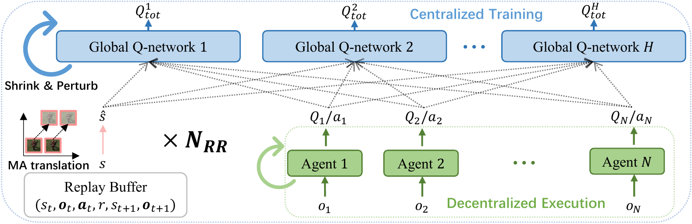
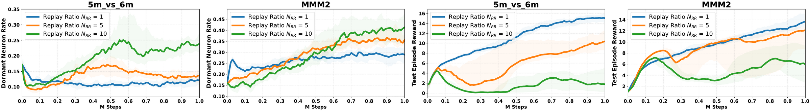
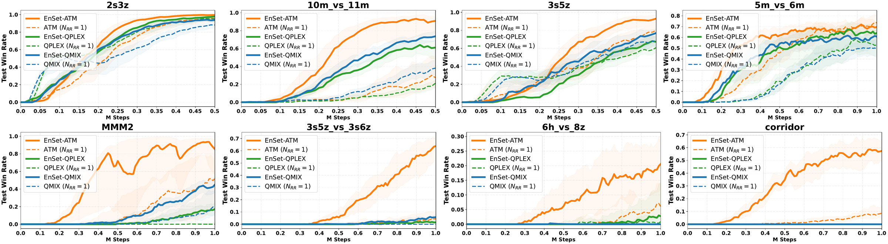
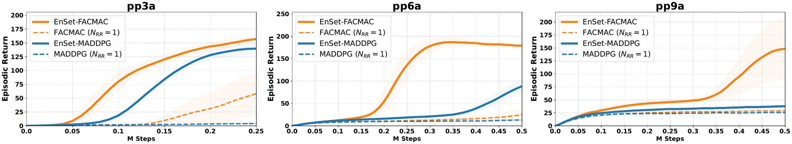
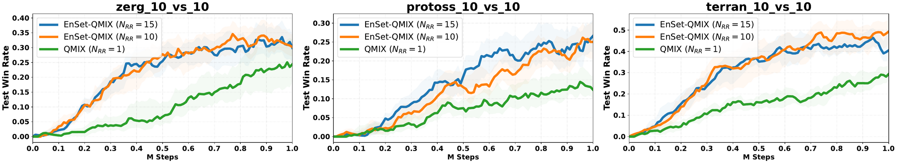

<div align="center">

# Boosting Multiagent Reinforcement Learning at High Replay Ratios with Ensemble Reset

[](https://neurips.cc/Conferences/2026)
[](LICENSE)

</div>

Official code for the NeurIPS 2026 paper "Boosting Multiagent Reinforcement Learning at High Replay Ratios with Ensemble Reset".

## 1. Overview

A high replay ratio updates the networks many times per environment interaction. It is an effective way to improve sample efficiency in reinforcement learning. In multiagent reinforcement learning (MARL), we find that high replay ratios induce a severe dormant neuron problem in the centralized global Q-network. Many neurons become inactive, which reduces network capacity and destabilizes learning.

We propose **Ensemble Reset (EnSet)** to stabilize MARL training at high replay ratios. EnSet has two components on the global Q-network:

- **Global Q-network ensemble reset**: an ensemble of $H$ global Q-networks trained with the averaged loss, plus periodic Shrink & Perturb on the global Q-networks and agent networks. Our theory shows that the ensemble reduces the gradient mean and variance of each global Q-network, thus reducing the probability of dormant neurons.
- **Multiagent translation augmentation**: a random translation of all unit positions in the global state. It exploits multiagent translation invariance to diversify replay experience and prevent overfitting.

<p align="center">
  
</p>
<p align="center"><em>The EnSet framework, trained under a high replay ratio N<sub>RR</sub>.</em></p>

### 1.1 Dormant neurons at high replay ratios

With QMIX, the dormant neuron rate in the global Q-network grows with the replay ratio. At a replay ratio of 10, learning collapses.

<p align="center">
  
</p>

## 2. Results

EnSet consistently improves various MARL algorithms at high replay ratios with fewer environment steps in SMAC, MPE, and SMACv2.

### 2.1 SMAC

EnSet-QMIX, EnSet-QPLEX, and EnSet-ATM use a replay ratio of 10. QMIX, QPLEX, and ATM use the default replay ratio of 1. Solid lines are medians and shaded areas are the 25th to 75th percentiles.

<p align="center">
  
</p>

### 2.2 MPE

EnSet-MADDPG and EnSet-FACMAC use a replay ratio of 25. MADDPG and FACMAC use a replay ratio of 1.

<p align="center">
  
</p>

### 2.3 SMACv2

EnSet-QMIX uses a replay ratio of 10 or 15. QMIX uses the default replay ratio of 1. Solid lines are medians and shaded areas are the 25th to 75th percentiles.

<p align="center">
  
</p>

## 3. Structure

```
smac/     EnSet-QMIX in SMAC (built on PyMARL)
smacv2/   EnSet-QMIX in SMACv2 (built on pymarl2)
mpe/      EnSet-MADDPG and EnSet-FACMAC in MPE predator-prey (built on FACMAC)
```

Main EnSet files:

| | SMAC | SMACv2 | MPE |
|---|---|---|---|
| Learner | `smac/src/learners/enset_q_learner.py` | `smacv2/src/learners/enset_nq_learner.py` | `mpe/src/learners/enset_maddpg_learner.py`, `mpe/src/learners/enset_facmac_learner.py` |
| Global Q-network ensemble | `smac/src/modules/mixers/eqmix.py` | `smacv2/src/modules/mixers/enmix.py` | `mpe/src/modules/critics/emaddpg.py`, `mpe/src/modules/mixers/eqmix.py`, `mpe/src/modules/critics/efacmac.py` |
| Config | `smac/src/config/algs/enset_qmix.yaml` | `smacv2/src/config/algs/enset_qmix.yaml` | `mpe/src/config/algs/enset_maddpg_pp.yaml`, `mpe/src/config/algs/enset_facmac_pp.yaml` |

## 4. Installation

Please follow the installation instructions of the codebases we build on:

- `smac/`: [PyMARL](https://github.com/oxwhirl/pymarl) and [SMAC](https://github.com/oxwhirl/smac)
- `smacv2/`: [pymarl2](https://github.com/hijkzzz/pymarl2) and [SMACv2](https://github.com/oxwhirl/smacv2)
- `mpe/`: [FACMAC](https://github.com/oxwhirl/facmac)

We use StarCraft II version 4.6.2.69232.

## 5. Running

### 5.1 SMAC

```
cd smac
python src/main.py --config=enset_qmix --env-config=sc2 with env_args.map_name=5m_vs_6m t_max=1020000 seed=1
```

Use `t_max=520000` for 2s3z, 3s5z, and 10m_vs_11m, and `t_max=1020000` for the other maps. The baseline QMIX uses `--config=qmix` (replay ratio 1).

### 5.2 SMACv2

```
cd smacv2
python src/main.py --config=enset_qmix --env-config=sc2_gen_zerg with env_args.capability_config.n_units=10 env_args.capability_config.n_enemies=10 seed=1
```

Use `--env-config=sc2_gen_protoss`, `sc2_gen_terran`, or `sc2_gen_zerg` for the three races. The default replay ratio is 15. Add `replay_ratio=10` for a replay ratio of 10. The baseline QMIX uses `--config=qmix`.

### 5.3 MPE

```
cd mpe
python src/main.py --config=enset_maddpg_pp --env-config=particle with env_args.scenario_name=continuous_pred_prey_3a seed=1
python src/main.py --config=enset_facmac_pp --env-config=particle with env_args.scenario_name=continuous_pred_prey_3a seed=1
```

Scenarios: `continuous_pred_prey_3a`, `continuous_pred_prey_6a`, `continuous_pred_prey_9a`. Add `t_max=270000` for pp3a (0.25M steps). The default `t_max=520000` is for pp6a and pp9a (0.5M steps). Baselines use `--config=maddpg_pp` and `--config=facmac_pp` (replay ratio 1).

## 6. Hyperparameters

All EnSet hyperparameters are shared across algorithms, tasks, and environments.

| Hyperparameter | Config key | Value |
|---|---|---|
| Ensemble size $H$ | `mixer_ensemble_N` | 5 |
| Replay ratio $N_{RR}$ | `replay_ratio` | 10 (SMAC), 15 or 10 (SMACv2), 25 (MPE) |
| Reset interval $T_R$ | `reset_interval` | 2000 |
| Shrink & Perturb interpolation $\alpha_r$ | `reset_mixer_alpha`, `reset_agent_alpha` | 0.8 |
| Translation range $\alpha_z$ | `perturb_alpha` | 0.2 |
| Observation scaling range | (in the learner) | [0.8, 1.2] |

Results are written by Sacred to `results/`.

## 7. Citation

If you find this code useful, please cite our paper:

```bibtex
@inproceedings{yang2026boosting,
  title     = {Boosting Multiagent Reinforcement Learning at High Replay Ratios with Ensemble Reset},
  author    = {Yang, Yaodong and Tang, Hongyao and Chen, Guangyong and Heng, Pheng-Ann},
  booktitle = {Advances in Neural Information Processing Systems},
  year      = {2026}
}
```

## 8. Acknowledgements

This code is built on [PyMARL](https://github.com/oxwhirl/pymarl), [pymarl2](https://github.com/hijkzzz/pymarl2), [SMAC](https://github.com/oxwhirl/smac), [SMACv2](https://github.com/oxwhirl/smacv2), and [FACMAC](https://github.com/oxwhirl/facmac). We thank the authors for releasing their code.

## 9. License

This code is released under the Apache License 2.0, the same as PyMARL and pymarl2. The `mpe/` folder is based on FACMAC, which is released without a license file.
